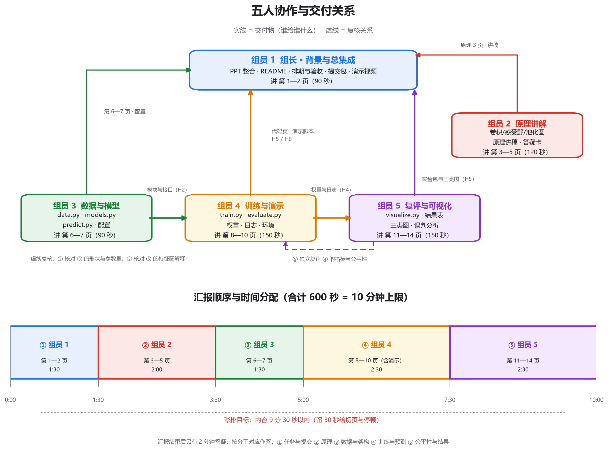
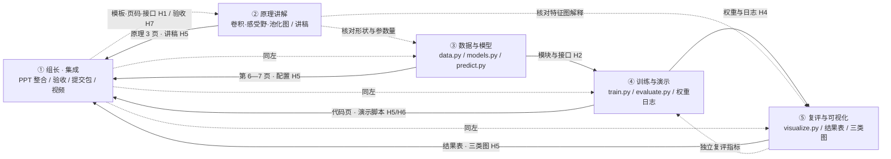

# 五人协作与交付关系

依据：[CNN任务总体方案](CNN任务总体方案.md)、[CNN五人分工与协作细则](CNN五人分工与协作细则.md)。

> 图片源文件：[`make_team_diagram.py`](make_team_diagram.py)，改完重跑即可更新。

---

## 一、五条主线（一句话版）

1. **组员 1 是唯一的汇聚点**：其他四人的产物最终都交给他整合成 PPT 与提交包。
2. **3 → 4 → 5 是一条技术流水线**：数据与模型 → 训练与日志 → 复评与可视化，顺序不能乱。
3. **组员 2 与代码链并行**：他只用别人已定的结构做原理图，不依赖训练结果，可以最早开工。
4. **组员 5 是"裁判"不是"队友"**：他独立复评 4 的实验，两人不共用同一份计算结果。
5. **组员 1 反向对全员负责**：下发模板与接口约定（H1）、组织验收与提交（H7）。

---

## 二、交付物流向

| 交付方 | 接收方 | 交付内容 | 节点 | 时间 |
|---|---|---|---|---|
| 1、3、4、5 | 全员 | PPT 模板、页码、目录与接口约定、日志字段 | H1 | 第 1 天结束前 |
| 3 | 4、5 | 模块、调用示例、形状参数表、`forward_features` 接口 | H2 | 第 2 天前半段 |
| 4 | 5、1 | 可运行的训练/评估/保存/加载流程、阶段日志 | H3 | 第 2 天结束前 |
| 4 | 5 | 冻结配置、权重、完整日志、环境与命令 | H4 | 第 3 天前半段 |
| 2、3、4、5 | 1 | 各自 PPT 页、图、讲稿、数据出处 | H5 | 第 3 天结束前 |
| 4 | 1、3 | 演示脚本、现场命令、最终讲稿 | H6 | 第 4 天 |
| 1 组织 | 全员确认 | 解压后的提交包、检查结果、实际贡献 | H7 | 第 5 天 |

**特殊的一处往返**：组员 4 写演示脚本 → 组员 1 录制备用视频 → 组员 4 现场使用该视频兜底。所以 1 与 4 之间是双向的。

---

## 三、复核与验收关系

| 复核方 | 被复核方 | 复核内容 |
|---|---|---|
| 组员 2 | 组员 3 | 形状表、参数量、讲稿中的数学与概念 |
| 组员 2 | 组员 5 | 卷积核与特征图的层名、通道、截取位置解释 |
| 组员 5 | 组员 4 | **独立复评**：另起目录与进程重算测试指标，核对样本数 |
| 组员 3 | 组员 4 | 调用是否正确、权重是否对应冻结结构 |
| 组员 4 | 组员 3 | 三种加载器可用、单图预测预处理与训练一致 |
| 组员 1 | 全员 | 进度、数字出处、版式、最终验收与提交 |
| 组员 5 | 组员 1 | 协助最终文件清单核对与验收 |

> 原则：**一项产出只有一名最终负责人，同时指定复核人**。复核不是帮忙，是必须留下记录的验收动作。

---

## 四、汇报顺序与时间（总计 600 秒）

| 顺序 | 讲者 | 页码 | 时长 | 内容 |
|---|---|---|---:|---|
| ① | 组员 1 | 1—2 | 90 s | 问题提出、FC 处理图像的局限 |
| ② | 组员 2 | 3—5 | 120 s | 卷积运算、感受野、池化 |
| ③ | 组员 3 | 6—7 | 90 s | 数据与预处理、网络结构、参数量 |
| ④ | 组员 4 | 8—10 | 150 s | 关键代码、训练闭环、单图演示 |
| ⑤ | 组员 5 | 11—14 | 150 s | 结果对比、曲线、特征图、误判与结论 |

彩排目标 9 分 30 秒以内，留 30 秒给切页与停顿；之后另有 2 分钟答疑。

**答疑归属**：① 任务目标与提交 ｜ ② 卷积·感受野·池化 ｜ ③ 数据划分·形状·参数量 ｜ ④ 损失·反向传播·模式切换·预测 ｜ ⑤ 公平比较·曲线·误判·局限。

---

## 五、协作规则（避免互相阻塞）

- **一个文件只有一名写者**：`models.py` / `predict.py` 归 3，`train.py` / `evaluate.py` 归 4，`visualize.py` 归 5，PPT 整合归 1。
- **下游等上游时先做别的**：4 等 3 的模型时，先写训练骨架与冒烟检查；5 等 4 的权重时，先用阶段日志调通绘图并标明"临时"。
- **接口一经交接不得悄悄改**：改 `forward_features` 的返回结构必须同时通知 5。
- **1 不替别人改技术结论**：数字有争议时由负责人出依据，不能凭印象调整。
